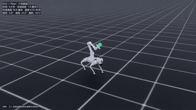
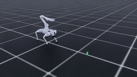
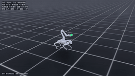
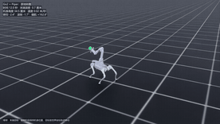
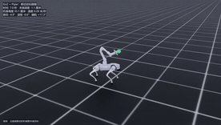
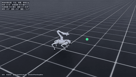

# Go2 + Piper Whole-Body Locomotion and Ground Pickup

[简体中文](README.md)

[Result index](results/README.md)

## Real-time simulation videos
[](videos/04-s-curve.mp4)
[](videos/03-ground-pick.mp4)
[](videos/05-walk-run-walk.mp4)

[](videos/01-spin.mp4)
[](videos/06-target-following.mp4)
[](videos/02-walk-spin-walk.mp4)

[S-curve](videos/04-s-curve.mp4) · [Ground pickup](videos/03-ground-pick.mp4) · [Walk–run](videos/05-walk-run-walk.mp4) · [In-place turn](videos/01-spin.mp4) · [Target tracking](videos/06-target-following.mp4) · [Walk–turn–walk](videos/02-walk-spin-walk.mp4)

This Isaac Lab project controls a Unitree Go2 carrying a Piper arm. It covers in-place turns, walking into and out of a turn, S-curve target tracking, walk-to-run transitions, and ground pickup. A learned policy controls the approach. Ground pickup combines staged joint control with end-effector feedback for crouching, grasping, and lifting.

## Demos and results

After the mount update, the general v8 policy was fine-tuned for 600 iterations. It passed all 128 episodes in each turn and walk–turn–walk suite, and all 256 episodes in two fresh curve and mixed-route suites. The existing specialized S-curve and walk–run policies each passed 127/128 on the updated asset, while pickup passed 48/48 across three placements. [Updated results](results/) · [Adapted model](runs/user_mount_adapt_v8/)

The results below include baselines from before the mount update. Video links point to the new recordings shown above.

- **In-place turn and walk–turn–walk**. V8 passed 128/128 fresh episodes in each task without falls. [In-place turn](videos/01-spin.mp4) · [Walk–turn–walk](videos/02-walk-spin-walk.mp4) · [Turn results](results/stability_v8_fresh_spin/evaluation.json) · [Transition results](results/stability_v8_fresh_transition/evaluation.json)
- **Ground pickup**. All 48 episodes at three object placements succeeded without falls. The initial distance ranged from 1.05 to 1.45 m, and the block was lifted about 19.1–19.2 cm. [Pickup video](videos/03-ground-pick.mp4) · [Episode data](results/)
- **S-curve walking**. V8 and the specialized model each passed 127/128 paired episodes. Yaw acceleration RMS decreased from 2.05 to 1.65 rad/s², and mean end-effector error decreased from 1.02 to 0.92 cm. [S-curve video](videos/04-s-curve.mp4) · [Gait metrics](results/s_curve_test/gait_quality.json)
- **Walk–run–walk**. Mean forward speed progressed from about 0.28 to 1.72 and back to 0.28 m/s. The policy passed 127/128 episodes with one fall. In 19 episodes, all four feet were clear of the ground on two consecutive samples during the fast segment. Sustained flight remains inconsistent. [Walk–run video](videos/05-walk-run-walk.mp4) · [Speed and contact metrics](results/walk_run_v3_contact/walk_run_metrics.json)

The videos are real-time simulation recordings. Evaluation used flat ground, and pickup used a small block at a known position. V8 still fell in a few curve and mixed-route episodes. The repository contains separate checkpoints for general coordination, S-curve walking, and walk–run transitions.

## Reproduce the demos

The tested Windows environment used Isaac Lab 3.0.0, Isaac Sim 6.0.1, Python 3.12, PyTorch 2.11 with CUDA 12.8, and RSL-RL 5.0.1. The [reproduction guide](REPRODUCE.en.md) covers the full path: `scripts/build_asset.py` downloads the Go2 + Piper meshes at a pinned upstream commit and builds the USD (both mount geometries), `scripts/convert_asset.py` runs the URDF → USD conversion, `scripts/stages.json` records the starting checkpoint, seed, learning rate and gait recipe of all 10 training stages, and `scripts/train_stage.py` drives them stage by stage. The saved checkpoints under `runs/` support playback and further training. The earliest upstream checkpoint is missing, and some historical configurations differ from the current scripts. This repository includes the [Python task extension](isaaclab_extension/); for a new installation, place the two packages under `isaaclab_tasks/manager_based/locomanipulation/`, follow the [asset configuration](isaaclab_extension/roboduet_go2piper/robots.py), and verify that `Isaac-Go2Piper-Walk-v0` is registered.

Run from the repository root with the configured Isaac Lab Python to replay the videos (real time, recording enabled):
```powershell
python run_adaptive.py --mode eval --pattern transition --checkpoint runs/user_mount_adapt_v8/model_final.pt --num_envs 1 --seed 1419 --run_name replay_spin --video
python run_adaptive.py --mode eval --pattern serpentine --checkpoint runs/s_curve_v1/model_final.pt --num_envs 1 --seed 1482 --run_name replay_s --video
python run_adaptive.py --mode eval --pattern walk_run --checkpoint runs/walk_run_v3/model_final.pt --num_envs 1 --seed 1581 --run_name replay_run --video
python run_ground_pick.py --run-name replay_pick --seed 1161 --video
```

## License

Original project code and documentation are licensed under the [MIT License](LICENSE). Third-party code and assets retain their upstream terms. See the notices for the [Isaac Lab extension](isaaclab_extension/LICENSE), [Walk These Ways](references/WTW_LICENSE), and [Unitree RL Lab](references/UNITREE_LICENSE). Upstream terms also apply to any upstream material included in the model weights.
