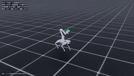
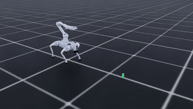
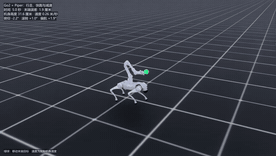
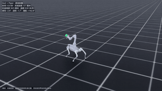
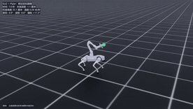
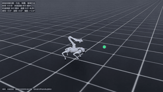

# Go2 + Piper 全身运动与地面拾取

[English](README.en.md)

## 原速仿真录像
[](videos/04-s-curve.mp4)
[](videos/03-ground-pick.mp4)
[](videos/05-walk-run-walk.mp4)

[](videos/01-spin.mp4)
[](videos/06-target-following.mp4)
[](videos/02-walk-spin-walk.mp4)

[S 型曲线](videos/04-s-curve.mp4) · [下蹲夹取](videos/03-ground-pick.mp4) · [走跑过渡](videos/05-walk-run-walk.mp4) · [原地转圈](videos/01-spin.mp4) · [目标跟随](videos/06-target-following.mp4) · [行走与转圈切换](videos/02-walk-spin-walk.mp4)

本项目在 Isaac Lab 中控制搭载 Piper 机械臂的 Unitree Go2，覆盖原地转圈、行进与转圈切换、S 型跟踪、走跑过渡和地面拾取。行走使用强化学习策略，地面拾取的下蹲与夹取使用分阶段关节控制和末端反馈。

## 演示与结果

安装位置更新后，通用 v8 继续训练了 600 轮。适配策略在两组各 128 场的原地旋转和行进切换中全部达标，在新的曲线和混合路线两组共 256 场中也全部达标。S 型和走跑沿用专项模型，在新版 USD 上各为 127/128；三个拾取位置共 48/48 成功。[结果目录索引](results/README.md) · [适配模型](runs/user_mount_adapt_v8/)

下列数据包含安装位置更新前的基线，视频链接均指向顶部所示的新录像。

- **原地转圈与行进切换**：v8 在两组各 128 个独立场景中全部达标，零跌倒。[原地转圈视频](videos/01-spin.mp4) · [行走—转圈—行走视频](videos/02-walk-spin-walk.mp4) · [旋转测试](results/stability_v8_fresh_spin/evaluation.json) · [切换测试](results/stability_v8_fresh_transition/evaluation.json)
- **地面拾取**：三个目标位置共 48 次成功、零跌倒。初始距离 1.05–1.45 米，方块最终抬高约 19.1–19.2 厘米。[走近—下蹲—夹取—抬起视频](videos/03-ground-pick.mp4) · [逐场景数据](results/)
- **S 型行走**：同一批 128 场中，v8 和专项模型均为 127/128 达标。专项模型的偏航角加速度 RMS 从 2.05 降至 1.65 rad/s²，平均末端误差从 1.02 降至 0.92 厘米。[视频](videos/04-s-curve.mp4) · [步态数据](results/s_curve_test/gait_quality.json)
- **走跑过渡**：实际前进速度约为 0.28 → 1.72 → 0.28 m/s。127/128 达标，1 次跌倒。高速段 19 场测到至少连续两帧四脚同时离地，持续腾空仍不稳定。[视频](videos/05-walk-run-walk.mp4) · [速度与足部接触数据](results/walk_run_v3_contact/walk_run_metrics.json)

每个视频均为原速仿真。实验覆盖平地仿真，拾取使用已知位置的小方块。v8 的纯曲线和混合路线仍有少量跌倒。三个检查点分别对应通用协同、S 型和走跑任务。

## 复现

使用本项目验证过的 Windows 环境：Isaac Lab 3.0.0、Isaac Sim 6.0.1、Python 3.12、PyTorch 2.11 CUDA 12.8、RSL-RL 5.0.1。资产生成与训练流程见[复现指南](REPRODUCE.md)：`scripts/build_asset.py` 按固定上游 commit 拉取 Go2 + Piper 整机网格并生成 USD（安装座两种几何），`scripts/convert_asset.py` 完成 URDF → USD 转换，`scripts/stages.json` 记录 10 个训练阶段的起点权重、seed、学习率与步态配方，`scripts/train_stage.py` 逐阶段驱动训练。`runs/` 包含多个已保存检查点，可用其开展回放或继续训练；最早的上游检查点未提供，历史配置与当前脚本也并非完全一致。这里附有 [Isaac Lab 扩展 Python 源码](isaaclab_extension/)，新环境把两个包放在 Isaac Lab 的 `isaaclab_tasks/manager_based/locomanipulation/` 下，按 [资产配置](isaaclab_extension/roboduet_go2piper/robots.py) 放置模型，并确认注册了 `Isaac-Go2Piper-Walk-v0`。

在仓库根目录用已配置的 Isaac Lab Python 回放（原速、带录像）：
```powershell
python run_adaptive.py --mode eval --pattern transition --checkpoint runs/user_mount_adapt_v8/model_final.pt --num_envs 1 --seed 1419 --run_name replay_spin --video
python run_adaptive.py --mode eval --pattern serpentine --checkpoint runs/s_curve_v1/model_final.pt --num_envs 1 --seed 1482 --run_name replay_s --video
python run_adaptive.py --mode eval --pattern walk_run --checkpoint runs/walk_run_v3/model_final.pt --num_envs 1 --seed 1581 --run_name replay_run --video
python run_ground_pick.py --run-name replay_pick --seed 1161 --video
```

## 许可证

本项目原创代码和文档采用 [MIT 许可证](LICENSE)。第三方代码和资产沿用各自的上游许可。仓库中的第三方代码许可见 [Isaac Lab 扩展](isaaclab_extension/LICENSE)、[Walk These Ways](references/WTW_LICENSE) 和 [Unitree RL Lab](references/UNITREE_LICENSE)。训练权重如含上游内容，也受相应上游条款约束。
